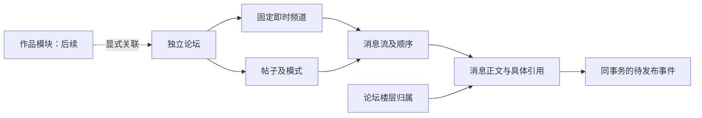

# 普通论坛切片与扩展边界

更新时间：2026-10-30。用户已澄清：ODYSSEIA 可作为普通论坛独立使用，卡／资源站只是应用形态；扩展性、低耦合、安全、性能和清楚代码是持续标准。本轮另已明确批准先验证登录成员论坛＋同帖引用，作品关联、游客访问、跨帖引用和完整身份组后续处理。

0.5.0 新增 chat 默认布局与固定即时频道；当前论坛接口与最低授权继续维护，详细频道契约见 [P3](P3讨论模式与固定频道-2026-10-30.md)。本文件后半验证日期保留历史时点。

## 已实现的边界

普通论坛不要求创建作品。当前数据库没有作品表，论坛仍能创建帖子、回复和读取历史。后续由作品模块显式关联论坛，不在论坛中增加强制 work_id，不用 owner_type／owner_id 或一个 JSON 字段包揽所有产品。



message 类型不导入 forum；通用消息表也没有 forum_id 或 work_id。forum.Entry 额外表达 root_id；quote_id 仍属于具体消息。两种关系独立，引用子回复仍归属指定主楼，不再嵌套一层。复合外键要求引用目标在同一消息流，root_id 只能指向本帖根楼的生成键，第三层在数据库层也被拒绝。

当前持久化事务编排在 PostgreSQL 适配中，正文／模式／层级校验在不依赖框架或数据库的 forum 模块；HTTP 通过明确接口调用。没有预建多层空服务、万能插件平台或每表接口。当前 message 只是公共模型与存储基础，不代表私聊、群聊或完整消息服务已经完成。

## HTTPS 接口

完整 [OpenAPI](../backend/internal/httpapi/openapi.json) 随 API 进程从 GET /openapi.json 提供，版本为 OpenAPI 3.2.1，info.version 为 0.6.0。全部论坛路由沿用统一 Access Token＋本地用户校验；作者来自可信身份，不能从请求正文或 X-User-ID 指定。论坛成员列表、加入、移除、角色和有效权限见 [协作面记录](协作面与模拟身份-2026-10-31.md)。帖子与频道写入仍检查当前成员关系。

| 方法与路径 | 当前行为 |
|---|---|
| GET /v1/forums/{forum_id} | 读取成员可见论坛。 |
| GET /v1/forums/{forum_id}/topics | 按论坛创建位置向前分页。 |
| POST /v1/forums/{forum_id}/topics | 创建 threaded 帖子和开帖正文。 |
| GET /v1/topics/{topic_id} | 读取帖子元数据，正文由消息历史提供。 |
| GET /v1/topics/{topic_id}/messages | 按消息创建序号向前分页，返回根楼归属与具体引用。 |
| POST /v1/topics/{topic_id}/messages | 发主楼或一层子回复；引用仅允许本帖目标。 |

两个 POST 必须带 UUID 格式 Idempotency-Key。同一用户、目标集合与 key 的相同解析内容返回原 201 结果；内容不同返回 409。开帖命令与帖内消息各自拥有幂等范围。GET 不更新已读或其他业务状态。

分页默认 50、最大 100；after 是绑定资源及集合类型的版本化游标，next 省略表示当前没有下一页。游标不是权限凭据，每次读取仍查当前成员关系。数据库使用范围条件及唯一索引，不用 OFFSET，不按返回行逐条查用户或引用。引用目标最多一次批量查询；遍历仅用于处理已经取得的结果和预建 map。

本轮工程上限为标题 200 个 Unicode 字符、正文 32 KiB UTF-8、请求 JSON 256 KiB；空白正文、无效 UTF-8、NUL、未知请求字段被拒绝。它们是当前切片边界，后续配置／产品规格另行维护。整数位置使用 JSON 字符串，避免前端数值精度损失。正文以文本保存，前端不得将未经处理的内容直接当作可信 HTML。

成员无权访问与资源不存在都返回 404/resource_not_found；引用无效统一返回 422/invalid_reference，不透露其他帖的内容。格式问题为 400，过大请求为 413，读取超时为 408，内容错误为 422。响应使用现有 problem+json 和 no-store 规则，不向调用者输出数据库错误。

消息页缓存只保存追加型内容；每个调用者先从数据库检查当前成员与流位置，再按固定前缀上界共享内容。其他实例追加会推进未满页缓存键；已满前缀可继续复用。缓存不保存授权、拒绝结果或身份，已经通过检查的在途读取可按该次快照完成。估计成本 64MiB、TTL 5 分钟均非权限时效；实现编辑／删除前须加入版本／失效，同键内容加载以 singleflight 合并，细节见 [当前记录](缓存分区与准入修复-2026-10-29.md)。

## 事务与实时边界

同一论坛的开帖位置、同一帖子消息流的创建序号分别由行锁串行分配，持有到事务结束；不把全局自增主键当成消息提交顺序。唯一键防止同范围重复写入，生成键外键防止更深层级与跨流引用。正文与待发布命令写在同一事务，晚期事件写入失败会回滚消息、帖子、消息流与位置计数。

2026-10-29 的 [回复优化](热点写入优化与对照-2026-10-29.md)在上述边界内使用小 CTE 更新计数器／插入正文，再用数据库返回的序号和时间编码事件，通过 pgx.Batch 写关系与事件。加锁后的幂等查询保留为独立语句，批次两项任一失败都会回滚外层事务；返回和事件契约不变。

当前 0.5.1 准入按论坛／流最多 1 个活动写者、12 个活动／等待命令，池 16 时自动预算为 10 个写事务、共 256 命令、两段等待共用 2 秒；可通过 ODYSSEIA_MAX_WRITE_TRANSACTIONS 显式配置，不超过该 API 池上限。它在共享池中留下调度余量，不是单独的读取池或全站配额。权限入队前检查，事务内复查；503／Retry-After: 1 保留，重试复用原键。分池、借用和动态份额未采用，候选及局限见 [整体对照](整体优化与写预算对照-2026-10-30.md)。

0.4.5 将回复的流锁、幂等读取及可选引用元数据作为同一 pgx.Batch 的独立语句，锁后的 READ COMMITTED 新快照仍保留，并以实际阻塞／并发提交验证；重试直接返回完整原记录。引用校验仍是最多一次集合查询，只取 ID／根楼归属。事务原子性、行锁序号、授权和引用规则保持。

0.5.1 回复在流锁时取得最新计数器和数据库事务时间，继续使用同一 Go 信封编码器，将计数器／正文、可选关系及 Outbox 合为一个 pgx.Batch；返回的序号／时间须与锁定值一致，全部结果和错误排空后才允许提交。锁后的幂等／引用保持独立语句的新快照，失败整体回滚。

当前可创建 threaded（贴吧式）、chat（即时式）帖子，以及继承论坛成员的固定即时频道，详见 [P3](P3讨论模式与固定频道-2026-10-30.md)。两种帖子仍支持根楼与同帖引用，频道支持同频道引用；三者的新内容均经 WSS 更新。[此前 threaded 多热帖负载](多热帖与实时扇出压测-2026-10-29.md)和[缓存／分区记录](缓存分区与准入修复-2026-10-29.md)保留历史条件，不能代替三形态或多实例容量验收；当前整体测量见 [最新对照](整体优化与写预算对照-2026-10-30.md)。

realtime_outbox 按 [Centrifugo 官方消费者](https://centrifugal.dev/docs/server/consumers) 的列结构准备。只有 postgres/forum_events.go 组装 publish 命令；业务事件具有稳定 UUID、version=1、type、scope_id、position 和 data，并将事件 UUID 用作 idempotency_key。forum.topic.created 的 scope_id／position 对应论坛；forum.message.created 对应帖子消息流。创建事件的序号不冒充未来编辑／删除变更游标。

**已在合成环境接通官方 Centrifugo 6.10.2 消费器与 WSS，P2 后端 A01–A08 已完成。** SDK 0.13.0 验证实际投递、短恢复、原生重启、双节点重试／恢复／撤权、真实 65 秒消费中断和七页 HTTPS／实时合并。不自写发布 worker；outbox 不承担长期变更日志。正式故障 SLA、高可用、小时级积压与乱序注入留作上线验收。

失去内存流后 SDK 报告恢复不连续、epoch 改变，可从 HTTPS 补读；未确认命令跨重启重放同一事件，正文仍唯一。共享 broker 仍在时可跨节点恢复原 epoch；历史真实过期后补读再合并。字段（信封 position／消息体 sequence）见 [接入契约](实时服务重启与事件接入契约-2026-10-29.md)，完整结果见 [P2 验收与交接](P2后端验收与交接-2026-10-29.md)。

当前 bodyless POST 为 /v1/realtime/connection-token、/v1/forums/{forum_id}/subscription、/v1/topics/{topic_id}/subscription、/v1/channels/{channel_id}/subscription。只签发最多 60 秒且不延长原 Access Token 的连接 JWT；三个 subscription 路由返回 channel 描述，不签发频道 JWT。Centrifugo 每次订阅调用受独立服务凭据保护的 HTTPS 代理，复用 GetForum／GetTopic／GetChannel 的当前授权，客户端 data 不授予权限；旧频道 JWT 路径已移除。配置和前端迁移见 [实时说明](../backend/deploy/realtime/README.md)。

维护命令 RemoveMember 同事务删除成员、记录操作审计并排入主动 disconnect；幂等、失败回滚、两台已有连接、晚到订阅响应及撤权后重订阅／历史拒绝通过。断连面向该用户全部实时连接、经消费者异步执行；提交成功不表示所有客户端已离开，故障时仍有窗口。不是零延迟承诺，也不提供真实 IdP 会话撤销；详见 [撤权与故障记录](成员撤权与消费者故障验证-2026-10-28.md)。

## 合成环境的准备与权限

先按 [身份接入](身份接入与API契约.md) 准备本地测试用户并应用全部八项迁移；第六项须遵守 [停写／排空／消费者同步升级](../backend/deploy/realtime/README.md)。使用独立维护账号，在进程环境设置 ODYSSEIA_MIGRATION_DATABASE_URL、ODYSSEIA_FORUM_TITLE、ODYSSEIA_FORUM_MEMBER_IDS 后运行：

```powershell
go run ./cmd/provision-forum
```

成员变量是逗号分隔的本地用户 UUID。每次命令显式创建一个新论坛并批量建立成员关系；输出 forum_id，不创建作品。命令不是正式建站、注册或管理员权限 API。

API 账号保留 users SELECT。以夹具角色名为例，维护账号在迁移后额外授予以下权限，不授予创建论坛／修改成员／编辑正文的能力：

```sql
GRANT SELECT ON odysseia.forums, odysseia.forum_members, odysseia.message_streams,
    odysseia.topics, odysseia.messages, odysseia.forum_entries, odysseia.channels TO odysseia_runtime;
GRANT INSERT ON odysseia.message_streams, odysseia.topics, odysseia.messages,
    odysseia.forum_entries, odysseia.channels TO odysseia_runtime;
GRANT INSERT(method, payload) ON odysseia.realtime_outbox TO odysseia_runtime;
GRANT USAGE ON SEQUENCE odysseia.realtime_outbox_id_seq TO odysseia_runtime;
GRANT UPDATE(last_topic_position) ON odysseia.forums TO odysseia_runtime;
GRANT UPDATE(last_position) ON odysseia.message_streams TO odysseia_runtime;
```

成员由显式测试关系控制，当前成员均可读写，并非完整身份组算法。撤销成员后，新请求及幂等重试都被拒绝；已经通过成员检查的在途事务按该次检查的快照处理，不承诺取消它们。主动实时断连与故障限制见 [积压与处置](实时积压检查与故障处置.md)，持续刷新连接的正式故障时限尚未验收。

## 复用与验证

本轮直接复用 pgx 的事务、连接池、结果收集，既有 goose／JWT／OpenAPI 工具继续使用；新增 [google/uuid v1.6.0](https://github.com/google/uuid/releases/tag/v1.6.0)，核对当日官方最新稳定发行及 BSD-3-Clause。分页参考 [Nakama 固定源码](https://github.com/heroiclabs/nakama/blob/7c94b8f3aa3a7550444a0c2cffee0969223f1ed9/server/core_channel.go) 的作用域检查、稳定范围分页和 limit+1，未复制其业务代码、gob 编码或兼容回退。来源和采用边界见 [复用索引](../../research/forum-slice-reuse-2026-10-28.sources.json)。

2026-10-28 已在独立 PostgreSQL 18.6 合成环境通过：无作品论坛、可信作者、成员隔离、同帖引用、数据库层级／跨流约束、12 路重复开帖与回复各只写入一份、8 路不同回复的唯一连续序号、冲突输入、页间插入和跨作用域游标拒绝，以及强制 outbox 写入失败后的完整回滚。HTTPS 实际响应均与 OpenAPI 对照验证；既有身份／TLS 测试、go vet 和 Linux/amd64 四个命令交叉构建通过。测试容器已清理。

这些是功能与并发边界测试，不是容量测试。当前 P2 后端已完成；前序 [复查记录](代码复查与实时接入-2026-10-28.md)与 [主动撤权／消费者故障记录](成员撤权与消费者故障验证-2026-10-28.md)保留当时范围。三万在线、热点吞吐、小时级积压、正式故障撤权上限、生产加密、真实 IdP、前端实际签收与完整管理审计仍按 [实施里程碑](后端边界与首个里程碑.md)中的后续门槛验证。

对架构问题的本轮检查：修改楼层规则主要涉及 forum、其 HTTP 契约和持久化约束；替换数据库主要调整 postgres 适配，替换实时组件主要调整事件适配及消费者；移除论坛路由及其入口装配后，身份和令牌校验仍能独立验证。作品尚未进入这些依赖路径。
